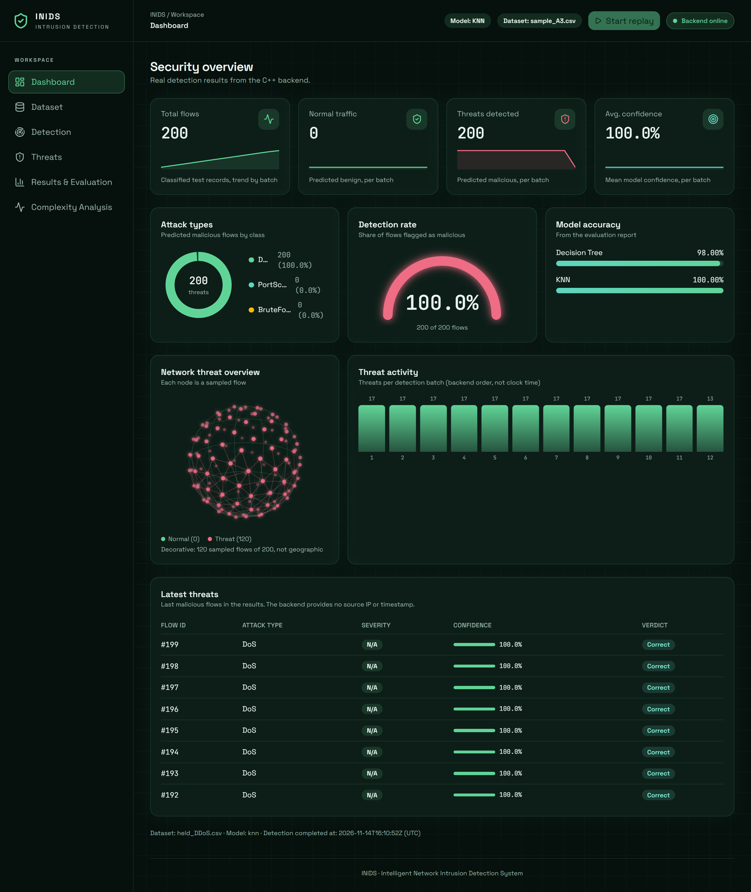
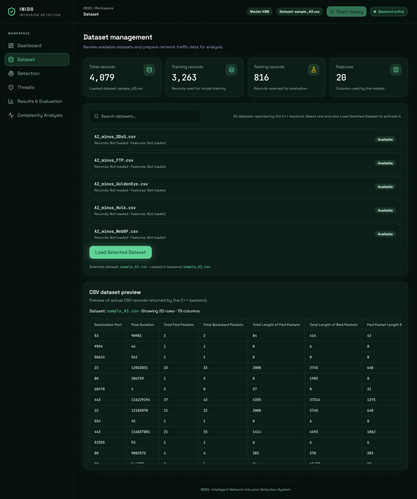
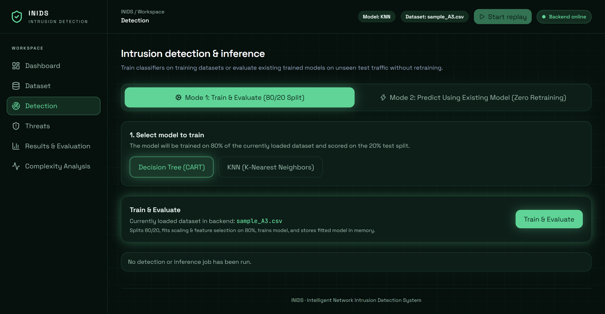
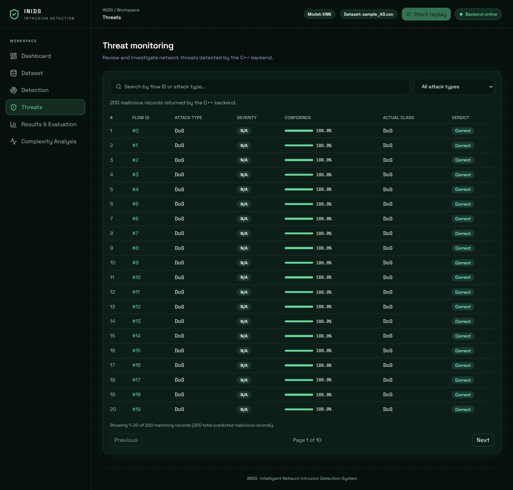
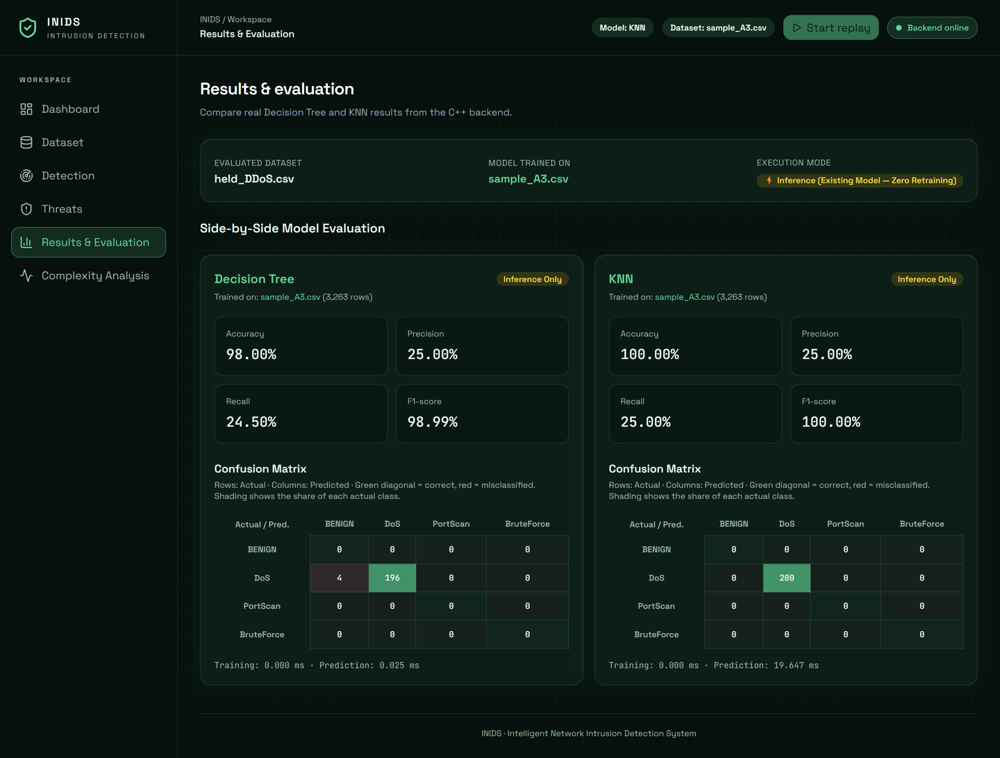
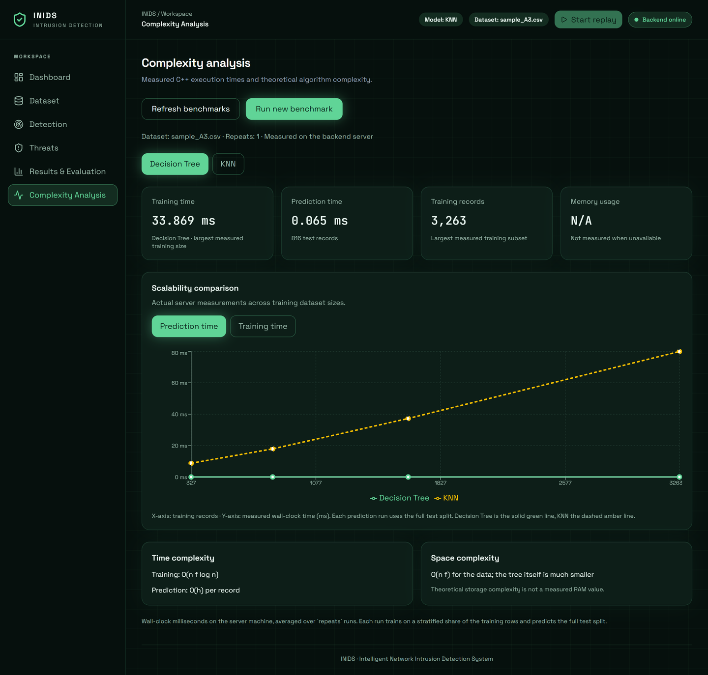
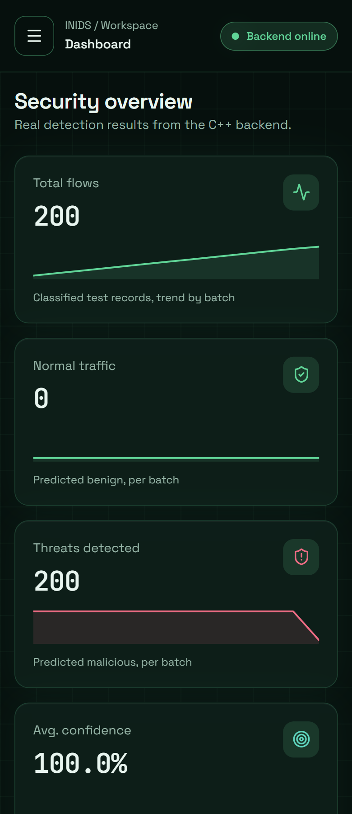
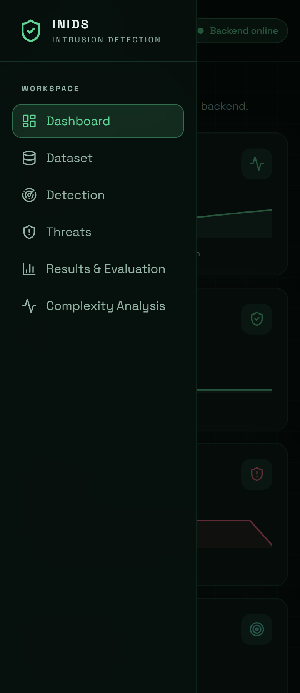
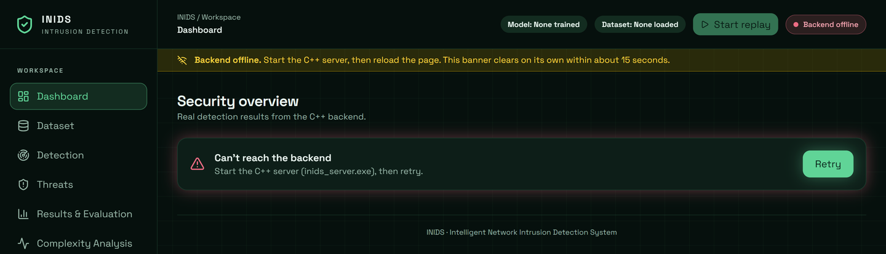

# INIDS frontend

React + TypeScript console for the INIDS intrusion detection backend (C++17, Decision Tree and KNN). It loads a dataset, trains or reuses a model, runs detection, and shows the results, threats, evaluation metrics and complexity benchmarks. The backend API is unchanged: this app only calls it over HTTP.



## Run it

Start the backend first (see the repository README), then:

```bash
cd gui
npm install
npm run dev
```

Open the address Vite prints (usually http://localhost:5173/).

| Script | What it does |
|---|---|
| `npm run dev` | Dev server |
| `npm run lint` | ESLint |
| `npm run typecheck` | TypeScript check |
| `npm run build` | Typecheck and production build |

The API address defaults to `http://127.0.0.1:8080`. Override it with `VITE_API_BASE_URL` in a `.env` file.

## Typical flow

1. **Dataset:** load a dataset (for example `sample_A3.csv`).
2. **Detection:** run **Train & Evaluate**, or evaluate a retained model on another file without retraining.
3. **Dashboard, Threats, Results:** review the outcome.
4. **Complexity:** run the benchmark and compare Decision Tree and KNN.

If the backend is not running, every page shows an offline banner and a clear message with Retry.

## Pages

| Page | Screenshot |
|---|---|
| Dashboard: stat cards, attack types, detection rate, model accuracy, threat activity, latest threats |  |
| Dataset: list, load, summary, CSV preview |  |
| Detection: train or predict, progress, results |  |
| Threats: search, filter, pages, details |  |
| Results & Evaluation: metrics and confusion matrices |  |
| Complexity: measured times and theory |  |

### Mobile and offline

| Mobile | Menu | Backend offline |
|---|---|---|
|  |  |  |

## What the data is, and is not

The backend provides no source IP or timestamp, so flows are identified by flow ID and nothing is invented. The activity charts group results by batch, in detection order, not by clock time. The globe is a decorative view of detections, not a map.

## Code layout

```
src/
  api/          client, endpoints, ApiError
  components/   layout, ui (glass panel, pill, button, skeleton), charts, threat, intro
  hooks/        useHealth, useHashPage
  lib/          navigation, describeError
  pages/        Dashboard, Dataset, Detection, Threats, Results, Complexity
  styles/       theme.css (design tokens)
  types/        api.ts
```

The active page is kept in the URL hash (`#dashboard`, `#dataset`, `#detection`, `#threats`, `#results`, `#complexity`). Colors, glows and radii are Tailwind v4 theme tokens in `src/styles/theme.css`.

## Accessibility and motion

Keyboard navigable with visible focus rings. Severity and status always carry a text label, not color alone. With `prefers-reduced-motion`, the boot sequence, globe rotation and count-up effects are turned off.
